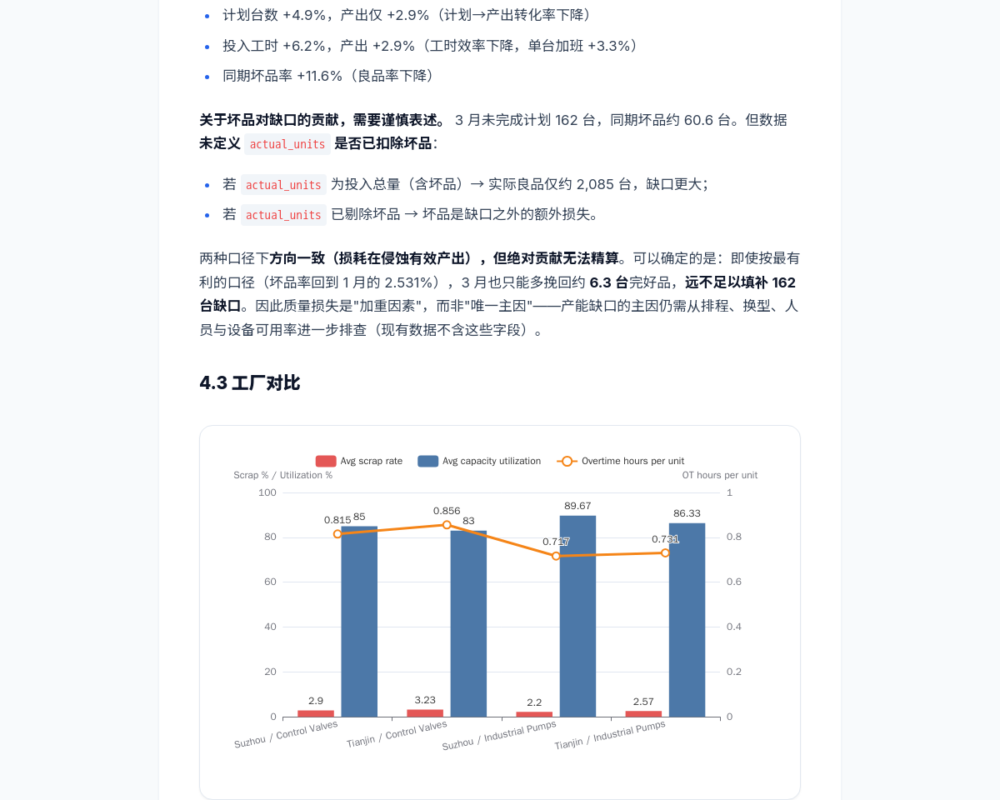
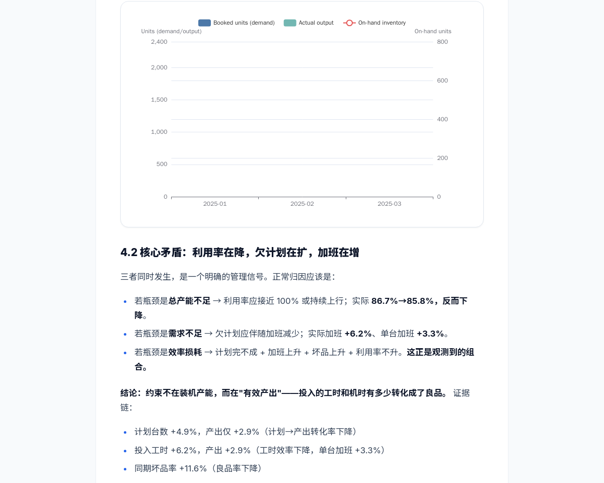

# 报告视觉回传（Report View Capture）

更新日期：2026-10-22

这份文档定义"让模型看到报告渲染结果"的实现方案。它只解决一件事：模型写完报告后，无法判断渲染是否正确。

## 决策记录

| 项 | 决定 | 理由 |
| --- | --- | --- |
| 传什么 | 渲染结果截图 + 结构化渲染事实 | 事实可门禁，像素负责视觉问题 |
| 传 HTML | 不传 | HTML 是后端用模型自己的输入确定性生成的，回传是噪音 |
| 缩图 | 不缩图，按 provider 原生上限切片 | 降采样糊掉正文，切片才能保清晰度 |
| 谁截 | 服务端 headless Chrome | 客户端视口不可复现，且依赖用户在线 |
| 时机 | 默认按变更增量截（a）；另提供手动"看我这一屏"（b） | 草稿期全量截图是噪音 |
| 进历史 | 不进。作为每轮重建的视图槽位 | messages 是 text 列，replay 语义不能改 |
| 门禁 | 不做像素门禁 | 像素不可断言，只能做上下文 |

## 1. 现状与约束

### 链路

```
blocks/charts/layout (模型写)
  → tools.RenderReportHTML            server/tools/report_html.go:35
  → tools.SanitizeReportHTML (服务端)  server/tools/report_sanitize.go
  → report update 事件 / 落盘产物 / 独立端点
  → sanitizeReportHTML (客户端, 第二层) client/src/utils/sanitize.js
  → iframe srcdoc 渲染                 client/src/components/report/ReportPreview.vue:89
```

模型全程只看得到自己写入的结构，看不到渲染结果。
服务端净化这一环见 §12：它让预览、下载产物、独立端点、以及后续的截图输入
拿到的是同一份字节。

模型全程只看得到自己写入的结构，看不到渲染结果。

### 约束事实

1. **LLM 链路是纯文本**。`LLMMessage.Content` 与 `ConversationItem.Content` 都是 `string`，
   全仓无 `image_url` / `inline_data`。多模态能力存在于模型侧，harness 侧未接线。
2. **两条渲染路径不一致**（**已解决，见 §12**）。此前应用内 iframe 走 sanitizer；
   独立报告 HTML 端点（`server/handler/run.go`）和落盘产物只靠 CSP，导致模型/用户/
   截图看到的不是同一份内容。现在三者统一由 `tools.SanitizeReportHTML` 产出。
3. **provider 视觉编码有硬上限**，超出即隐式降采样。量级如下，落地前需按实际部署模型复核：

   | provider | 行为 | 单图 token 量级 |
   | --- | --- | --- |
   | Anthropic | 长边 > 1568px 压缩 | 像素数 / 750 |
   | Gemini | > 384px 按 768px 切 tile | 258 / tile |
   | OpenAI vision | high detail 按 512px tile | 按 tile |

   结论：**不缩图的正确做法是切片，不是放大单图**。
4. **消息表是 text 列**（`server/migrations/001_init.sql:116`），
   `RebuildHistoryFromMessages` 纯文本重建。图片写进历史等于改 replay 语义。
5. **压缩压力只算文本**（`server/agent/tokens.go:62`）。图片不显式计价，
   压缩阈值会低估，可能静默顶爆上下文窗口。
6. **服务端不托管 `/assets`**。ECharts/KaTeX 由前端 nginx 提供，
   但 `config.ReportEchartsUrl` 可配；KaTeX 基址目前是常量，需要一起参数化。
7. **捕获必须使用 sanitizer 之后的 HTML**。服务端直接渲染未净化 HTML 并在浏览器里执行，
   是一个必须按沙箱对待的攻击面。

## 2. 架构

三段式，彼此可独立开关：

```
                 ┌──────────────────────────────┐
报告变更 ────────▶│ 捕获 capture (render-executor)│
 (debounce+脏块)  │  headless Chrome, 固定视口    │
                 └──────────────┬───────────────┘
                                │ PNG + 渲染事实
                 ┌──────────────▼───────────────┐
                 │ 缓存 store (对象存储, hash 键) │
                 └──────────────┬───────────────┘
                                │ 当前版本切片
                 ┌──────────────▼───────────────┐
下一轮请求前 ────▶│ 注入 view slot (runtime ctx)  │
                 │  末尾追加, 不进历史           │
                 └──────────────────────────────┘
```

## 3. 捕获规格

### 视口与切片

- 视口宽度固定 **1200 CSS px**，DPR 1。理由：PDF 打印窗口已经是 1200
  （`ReportPreview.vue:444`），而 iframe 是 100% 宽度（可变）。
  取 1200 作为唯一渲染口径，顺带收掉"预览宽度 ≠ 导出宽度"的既有不一致。
- 切片高度由 **provider 画像**决定，不写死。默认 `1200×960`：
  1200×960 = 1.152 Mpx，正好落在 Anthropic 类视觉编码的单图像素上限附近，
  不会被二次降采样。高度必须做成配置（`REPORT_VIEW_SLICE_HEIGHT`），
  因为 Gemini 按 768px tile、OpenAI high detail 按 512px tile 计费，最优尺寸不同。
- 切片单位：`.report-block-wrapper[data-block-id]`（`ReportHTML` 已输出该标记）。
- **切点必须避开原子元素**：`.chart-box`、`table`、`pre`、`figure`、`img`、
  `.katex-display`、`h1–h4`。硬切会把图表/表格从中间劈开，模型看到半张图会得出错误结论。
  规则：优先在 `cursor + maxHeight` 处切；若该切点落在原子元素内部，
  上移到该元素顶部（保留最小 320px 余量，否则仍按硬切，避免碎片化）。
- 超长块纵向分片，标记 `part i/n`。
- 产物：PNG，单张 ≤ 5MB。命名 `{run_id}/{report_version}/{block_id}-{part}.png`。


### 渲染稳定判定

全部满足后才截，否则重试一次（上限 8s）：

- `document.fonts.status === "loaded"`
- 所有 `` `complete === true`
- **每个 ECharts canvas 的 `toDataURL()` 长度连续两次采样一致**（不设长度阈值）
- `scrollWidth` / `scrollHeight` 连续两次采样一致
- `document.querySelectorAll(".katex-error").length === 0`
- 页面无 `pageerror` / `requestfailed`

就绪只表示"**页面不再变化**"，不表示"页面是对的"。因此：
**不要要求必须有 canvas，也不要要求 canvas 像素数超过阈值**——纯文字报告、
以及被渲染器拒绝的图表都不会有 canvas，这两条会让合法报告一直等到超时（§11 实测）。
"没有 canvas" 是合法终态，写进 `charts_missing` 事实即可。

注意：**不要用 `echarts.getInstanceByDom(el).isFinished()`**。探针验证该实例上
没有这个方法，任何基于它的就绪判定都会永久返回 false，导致每次捕获都白等到超时。
canvas 像素稳定性是唯一可靠的信号，实测稳定耗时 0.8–1.4s。

并且：**不要逐块调 `Page.captureScreenshot`**。实测 19 次 clip 需要 24s
（单次约 1.2s），而一次 `fullPage` 截图只要 3.4–5.8s，且裁剪结果与逐块 clip
**像素完全一致**（19/19 逐像素相等）。所以捕获只发一次截图，切片在服务端用
Go `image/png` 裁剪完成。


### 缓存键

```
sha256( block_html ‖ chart_option ‖ layout_css ‖ body_class
        ‖ viewport_width ‖ dpr ‖ asset_version )
```

未命中的块才裁剪；命中直接复用。`asset_version` 取 ECharts/KaTeX 资源版本，
避免资源升级后拿到旧图。整页截图仍然只有一次，缓存省掉的是裁剪与上行体积。

### 失败降级

超时、Chrome 崩溃、资源 404 一律不抛到 run 上：返回
`capture_facts{ok:false, reason, block_id}`，注入时只给事实不给图。

## 4. 注入规格（已落地）

- runtime context block：`name="report_view"`，`role=user`，由
  `ReportView.RuntimeContextBlocks()` 生成（`server/agent/report_view.go`）。
- 位置：`buildBundle` 末尾，jobs completion notice 之后，由
  `Engine.SetReportViewProvider` 提供数据源。
  理由：它每轮都变，放前面会让整个前缀缓存失效，prefill 成本和延迟随轮数线性上涨。
- **分块**：每个 block 最多 20 张图（`maxReportViewImagesPerBlock`），
  一行切片长报告会拆成 `chunk: "1/3"` 这样的多个 block。
  不这么做的直接后果是超出 `maxMessageImages`，请求被网关拒掉。
  事实与 `not_captured` 只放在第一块，后续块标 `continuation: true`，不重复占 token。
- **视图不进历史**，每轮按当前版本重建。因此每轮都会重新付一次图片 token——
  这就是为什么增量（只发脏块）是必需的，而不是优化项：全量视图 29 张约 36k token/轮。
- provider 返回 nil 表示"还没有就绪的捕获"，本轮只给事实不给图，**永不阻塞等待**。
- 内容 = 文本事实 + 图片 parts：

```json
{
  "report_version": 17,
  "captured_at": "finalize_precheck | dirty_blocks | manual_screen",
  "viewport": {"width": 1200, "dpr": 1},
  "blocks": [
    {"block_id": "b3", "kind": "chart", "part": "1/1", "w": 1200, "h": 450},
    {"block_id": "b7", "kind": "html", "part": "1/2", "w": 1200, "h": 960}
  ],
  "not_captured": [{"block_id": "b9", "reason": "capture_timeout"}],
  "render_facts": {
    "charts_mounted": 3, "charts_missing": [],
    "sanitized_nodes_removed": 2,
    "frames": [{"block_id": "b7", "katex_errors": 0, "img_failed": 1}]
  }
}
```

- 版本戳必须带 `report_version`（`ReportState.MutationVersion`）。否则模型会把图和过期状态对应。
- 每轮只注入**当前版本**的切片，不累积历史图。版本号缺失（`report_version <= 0`）
  的视图直接丢弃，避免模型拿着过期截图推理。
- 无法发送的切片（无 PNG、尺寸非法、单边超 4096）在构建时丢弃，
  让捕获缺陷退化成"少一张图"，而不是"请求被拒"。
- token 计价：按 **provider 降采样之后**的有效像素计，而不是原始面积——
  否则 1200×1500 会被高估约 38%。公式：

  ```
  scale = min(1, 1568 / max(w,h), sqrt(1_150_000 / (w*h)))
  tokens = ceil(w*h*scale² / 750)
  ```

  该值参与 `EstimatePromptTokens`，让压缩阈值仍然可信。常量随 provider 画像配置。

## 5. 接口

### 5.1 agent 侧类型（已落地）

```go
type MessagePart struct {
    Kind string // MessagePartText | MessagePartImage
    Text string
    MIME string // image/png | image/jpeg | image/webp
    Data []byte // 仅图片
    W, H int
}
```

`ConversationItem` 与 `RuntimeContextBlock` 各加 `Parts []MessagePart`。

语义要点：**`Parts` 是叠加，不是替换**。`payloadParts(text, parts)` 把 `Content`
作为首个 text part 放在图片之前，模型先读到"这是什么"，再看到图。
`Parts` 为空时序列化结果与改造前逐字节一致，由
`TestTextOnlyRequestsKeepTheirWireFormat` 守住——否则等于悄悄改掉所有历史请求。

载荷上限（防止生产端 bug 变成网关拒绝的巨额账单）：单条 32 个 part、24 张图、
单图 5MiB、单边 4096px。非法 MIME/尺寸在 `validatePromptBundle` 阶段就被拒绝，
不会等整个 prompt 发完才失败。

### 5.2 LLM adapter 映射（已落地）

| adapter | 位置 | 映射 |
| --- | --- | --- |
| OpenAI responses | `llm.go` `responsesContent` | `{"type":"input_image","image_url":"data:image/png;base64,..."}` |
| OpenAI chat_completions | `llm.go` `chatCompletionMessage.MarshalJSON` | `{"type":"image_url","image_url":{"url":"data:..."}}` |
| Anthropic | `llm.go` `anthropicParts` | `{"type":"image","source":{"type":"base64","media_type":"image/png",...}}` |
| Gemini | `llm_google.go` `geminiParts` | `{"inlineData":{"mimeType":"image/png","data":"..."}}` |

两个实现细节值得记下来：

- chat_completions 的 `content` 纯文本时是字符串、带图时是数组。用自定义
  `MarshalJSON` 切换，而不是把字段改成 `any`——后者会让 `omitempty` 失效，
  空字符串被序列化成 `"content":""`，改动所有无图请求。
- 四个适配点都有单测，断言的是**精确 wire JSON**（例如
  `{"role":"user","content":[{"type":"text","text":"view"},{"type":"image_url",...}]}`），
  不是"包含某字段"。多模态映射最容易错在结构层次，而不是字段存在性。

### 5.3 render-executor HTTP

```
POST /capture
{
  "html": "<完整报告 HTML>",
  "asset_base_url": "http://client/",
  "viewport": {"width": 1200, "dpr": 1},
  "timeout_ms": 8000
}
→
{
  "png_base64": "<整页截图>",
  "rects": {
    "scroll": {"w": 1200, "h": 23731},
    "blocks": [{"block_id": "b3", "kind": "markdown", "y": 8499, "h": 3893}],
    "atomic": [{"tag": "div", "y": 9303, "h": 450}]
  },
  "render_facts": {
    "scroll": {"w": 1200, "h": 23276},
    "overflow_x": false,
    "charts": [{"id": "cht_demand", "mounted": true, "canvas_w": 724, "canvas_h": 450}],
    "charts_missing": [],
    "katex_errors": 0,
    "images_failed": [],
    "blocked_requests": [],
    "page_errors": [],
    "scroll_settled": true,
    "readiness_samples": 9
  },
  "settle_ms": 823,
  "capture_ms": 3486
}

GET /healthz
```

只返回**一张整页 PNG + 布局矩形**，切片与裁剪由服务端完成（见"渲染稳定判定"）。
理由：逐块 clip 慢 7 倍且结果与裁剪完全等价；同时布局矩形让服务端可以按
provider 画像重新规划切片，不需要重启浏览器。

认证复用 python-executor 的 `PROXY_TOKEN` 模式。网络边界同样只挂在
`executor-network`，**必须无外网出口**——它执行的是模型生成的 HTML。


### 5.4 调用点

- 报告写工具返回后：debounce 500ms + 脏块判定，触发增量捕获。
- `report_finalize` 前：强制全量捕获一次，作为定稿自检视图。
- 手动 b：新 API `POST /api/sessions/{id}/runs/{run}/report/view`，前端按钮触发，单次不回写。

**捕获必须异步执行，不能阻塞 agent 步进。** 实测一次全量捕获（热实例）约
0.7s 跳转 + 1.2s 稳定 + 3.5s 截图 ≈ **5.4s**，冷启动再 +2s。所以：

- 捕获提交进现有 job 通道，键为 `(run_id, report_version)`；同一版本只取消重跑最新一次。
- 请求组装时取"当前已就绪的最新版本捕获"；未就绪则本轮不给图，只给
  `render_facts` 或空。**永远不为等图而阻塞**。
- 版本落后于 `ReportState.MutationVersion` 的捕获直接丢弃，避免注入过期视图。


## 6. 改动清单

| 文件 | 改动 | 风险 |
| --- | --- | --- |
| `server/tools/report_charts.go` | `resolveChartOption` 增加 series/axis/data 静态校验 | 低，纯增益 |
| `server/tools/report_html.go` | KaTeX 基址参数化；输出可切片标记；移除失效的外部字体 @import | 低 |
| `server/tools/report_sanitize.go`（已落地，§12） | 文档级输出净化 + `RenderSafeReportHTML` 唯一出口 | 中 |
| `testdata/report-sanitize-cases.json`（已落地，§12） | Go / JS 共用的净化断言语料 | 低 |
| `server/handler/{runtime_events,run}.go`（已落地，§12） | 三处输出边界改走 `RenderSafeReportHTML` | 低 |
| `server/agent/prompt_bundle.go`（已落地） | `MessagePart` + `Parts` 字段 + 载荷上限校验 | 中 |
| `server/agent/tokens.go`（已落地） | 按 provider 降采样后像素计价 | 中，影响压缩触发点 |
| `server/agent/llm.go`（已落地） | responses / chat_completions / anthropic 三处映射 | 中 |
| `server/agent/llm_google.go`（已落地） | `geminiPart.InlineData` | 低 |
| `server/agent/compaction.go` | 视图槽位追加到 bundle 末尾 | 低 |
| `server/agent/bundle` 调用方 | 注入 `report_view` block | 中 |
| `server/render/`（新增） | 捕获客户端、缓存、脏块判定、降级 | 中高 |
| `render-executor/`（新增） | chromedp 服务 + Dockerfile | 高，镜像 ~400MB |
| `docker-compose.yml` | 新服务，走 executor-network，无外网 | 中 |
| `server/config/config.go` | `REPORT_VIEW_CAPTURE=off\|facts\|images`、资源基址 | 低 |
| `client/src/components/report/ReportPreview.vue` | 手动 b 按钮 | 低 |
| `client/src/utils/sanitize.js`（已落地，§12） | 保持为第二层；新增共用语料断言 | 低 |

## 7. 分阶段落地

### P0：渲染事实（无图片，可独立上线）

- 服务端 `resolveChartOption` 静态校验：series 非空、axis 存在、dataset 有行。
- 报告快照 lint：chart 引用完整、evidence 可解析、sanitizer 会剥离的节点预判。
- 验收：一批已知空图表的 option 能被 finalize 前置拦截，错误码明确。

### P1：捕获服务（只截图，不注入）

- `render-executor` 起服务，`POST /capture` 返回整页 PNG + 布局矩形（见 §5.3）。
- 服务端实现切片规划器（原子元素避让 + provider 画像）与裁剪，先加调试端点人工核对。
- 验收（已在探针中全部达成，见 §10）：
  - 固定视口下同一 HTML 两次捕获**逐像素一致**（19/19 切片 sha256 相同）
  - 整页裁剪结果与逐块 clip **逐像素一致**（19/19）
  - ECharts 图表渲染非空、KaTeX 零错误、无 `pageerror`
  - 切片避让原子元素：跨切片图表数为 0
- 异常态验收（见 §11）：空 series / 删 series / block 重叠 / 表格超宽 / 注入脚本 /
  图表被拒 / 纯文字报告，8 个变体全部在 125–871ms 内就绪，且 `render_facts`
  分别给出 `charts_missing`、`overflow_x`、`script_ran`、`imgs_failed`。
- 捕获页必须带报告页 CSP 与 sanitizer（§11 安全发现），否则不予上线。


### P2a：类型与 adapter（已落地）

- `MessagePart` + 两个类型的 `Parts` 字段 + 载荷上限校验。
- 四个 adapter 映射 + 精确 wire JSON 断言 + 无图序列化逐字节回归。
- `EstimatePromptTokens` 按 provider 降采样后的像素计价。

验收（已达成）：无图请求 wire 格式不变（`TestTextOnlyRequestsKeepTheirWireFormat`）；
1200×960 切片计价 1534 token（不是原始面积的 1536/2400）；
非法载荷在 bundle 校验阶段被拒。

### P2b-1：视图槽位（已落地）

- `ReportView` 类型 + `ReportView.RuntimeContextBlocks()`（分块、版本戳、事实透传）。
- `Engine.SetReportViewProvider` + bundle 末尾注入。
- 验收（已达成）：视图必须是最后一个 runtime block（保护前缀缓存）；
  45 张切片拆成 3 块且每块 ≤20 图、通过载荷校验；
  捕获失败时退化为只有事实的块；无法发送的切片被丢弃而不是让请求失败；
  未就绪（nil）与非过期（`report_version<=0`）视图都不注入。

### P2b-2：捕获数据源（待做）

- 捕获结果落对象存储（hash 键）+ 脏块增量 + 异步 job（§5.4）。
- 把真实捕获接到 `SetReportViewProvider`，替换测试里的假数据。
- 验收：一次报告 run 中模型能引用截图中可见的版式问题；
  图片 token 计入后压缩触发点符合预期。

### P3：增量与手动 b

- 脏块 hash、debounce、手动"看我这一屏"端点与按钮。
- 验收：只改 1 个块时仅 1 张图进入请求；手动触发不影响自动流程。

## 8. 风险

| 风险 | 缓解 |
| --- | --- |
| 截图页执行模型生成 HTML | 只渲染 sanitizer 之后的 HTML；容器无外网、只读 FS、`cap_drop: ALL`、非 root；必要时 gVisor |
| provider 降采样不一致 | 按 provider 画像配切片尺寸；默认 1200×960 使其落在单图像素上限内（见 §10 表） |
| 前缀缓存被破坏 | 视图槽位固定放末尾；文本部分带稳定结构 |
| ECharts 截到空白 | canvas `toDataURL` 长度稳定作为就绪信号；空白检测（全透明/单色）计入 `render_facts`；失败一次重试 |
| 捕获拖慢步进 | 异步 job + 版本键；未就绪本轮不给图，绝不阻塞（见 §5.4） |
| 上行体积（19 张切片约 4MB） | 内网直连、脏块增量（常见 1–3 张）、并发上限 |
| 与 benchmark 复现冲突 | 捕获由开关控制，benchmark 默认 `facts` 模式 |

## 9. 与项目原则的一致性

- 观察面只给事实，不给建议：`render_facts` 是状态，不是"下一步该做什么"。
- 不把临时上下文塞进 policy：视图槽位在 runtime context 层，每轮重建。
- 可测试、可审计、可回滚：每个阶段一个开关（`off | facts | images`），可单独降级。
- 资源边界是事实：截图尺寸、超时、失败原因都作为显式字段返回。

## 10. P1 探针实测结果

用仓库里一份真实报告做验证（`data/storage/.../r_f7902b03edd42afd/report/report.html`）：
8 个 block、6 张 ECharts 图、KaTeX 公式、表格，整页 1200×23731（28.5 Mpx）。
环境：Chromium 124 + Puppeteer 22.9，容器内 headless，视口 1200 CSS px / DPR 1，
静态资源与前端同源。

按 960 规格从整页图裁出的一张真实切片，正文、行内代码、图表刻度与图例均可辨认：



### 已验证

| 结论 | 证据 |
| --- | --- |
| 渲染保真 | 切片内图表、双 Y 轴、旋转标签、表格、加粗、行内公式全部正确渲染，无 `pageerror` |
| 像素级确定性 | 连续两次捕获，19/19 切片 sha256 相同，整页图 sha 也相同（cap=1500 规格下测得；渲染路径一致，与切片高度无关） |
| 整页裁剪 ≡ 逐块 clip | 19/19 切片逐像素相等（numpy 比对 `maxdiff=0`） |
| 切片可避开图表 | 原子元素避让规则下，跨切片图表数 = 0 |
| 就绪信号 | canvas `toDataURL` 长度稳定，实测稳定耗时 0.8–1.4s；`isFinished()` 不存在于实例上，不可用 |
| 切片尺寸影响有效分辨率 | 见下表，960 高是"零降采样"的临界点 |

### 切片高度 vs 实际进入模型的 token

同一份报告，raw 面积估算恒定在 36.4k token 左右（面积守恒），
但 provider 对单图有长边 1568px / 约 1.15 Mpx 的上限，超出即二次降采样：

| 切片高度 | 切片数 | 单张像素 | provider 处理后 token | 有效分辨率 |
| --- | --- | --- | --- | --- |
| 1500 | 19 | 1200×1500 = 1.8 Mpx | 26.4k（被压 20%） | 960×1200 |
| 1200 | 24 | 1.44 Mpx | 32.1k（仍被压） | 1073×1073 |
| **960** | **29** | **1.152 Mpx** | **36.4k（零降采样）** | **1200×960** |
| 800 | 34 | 0.96 Mpx | 36.4k（零降采样） | 1200×800 |

结论：预算充足时选 960，用 1.5 倍 token 换 25% 的线性分辨率。
整页一张（1200×23731）经 provider 压到 79×1568 只有 **166 token**——
便宜，但缩放比 0.066，正文等于被销毁。这就是"整页直传"看似省钱实则无用的量化依据。

### 延迟（热实例）

| 阶段 | 耗时 |
| --- | --- |
| 页面加载（本地静态） | 0.65–2.0s（冷启 2.0s） |
| 渲染稳定 | 0.8–1.4s |
| 整页截图 | 3.4–5.8s |
| 逐块 clip ×19 | 24–25s（单次约 1.2s，比整页慢 7 倍） |
| 全量捕获总计 | ≈ 5.4s，冷启 ≈ 7.4s |

### 对原方案的修正

1. 切片高度从 1600 改为 **960**（配置化），否则会被 provider 二次降采样。
2. 就绪判定从 ECharts `finished` 事件改为 **canvas 像素稳定**；前者是 API 误用。
3. 捕获方式从"逐块 clip"改为 **一次整页截图 + 服务端裁剪**，快 7 倍且结果等价。
4. 捕获必须 **异步化**（5.4s 不能压在 agent 步进上），用 job + 版本键。

### 尚未验证（下一阶段需要补）

- provider 侧真实计费与降采样行为（本文按公开口径推算，需用实际 API 对账）。
- 异常态渲染：空数据图表、`custom_css` 把版式打崩、sanitizer 剥节点后的画面。
- 超长报告（> 32k px）下 Chrome 的纹理/内存上限；本样本 23.7k px 正常。
- 与客户端 sanitizer 的一致性：探针用的是直接 HTML，尚未走 sanitize 路径。

## 11. 异常态实测（P1 第二部分）

happy path 只能证明"能截"，不能证明"截了有用"。这一节用 8 个故意弄坏的变体回答：
**报告渲染出问题时，截图和结构化事实各自能发现什么。**
样本由 `scripts/report-view-spike/make_anomaly_samples.py` 从真实报告生成。

| 变体 | 制造的症状 | 结构化事实能否发现 | 截图能否发现 |
| --- | --- | --- | --- |
| v0 原始 | 正常 | — | — |
| v1 空 series | 图表有坐标系和图例，但没有数据 | 只能看到 canvas 像素数变化（60066→38062），**无基线则不可判** | **一眼可见** |
| v2 删掉 series | 图表只剩部分元素 | 同上（30202） | 可见 |
| v3 block 绝对定位 | 8 个 block 全部堆在 `y=0` 互相覆盖 | **直接暴露**：scroll 高度 23731→3941，8 个 block 同 y | **反而看不出来**（只显示最后绘制的一块，画面本身"正常"） |
| v4 表格超宽 | 内容宽 3239px，被视口裁掉 | **直接暴露**：`overflow_x=true`、scroll w=3239 | 可见右侧被裁 |
| v5 注入脚本 + 坏图 | `<script>` 执行、图片 404 | **直接暴露**：`script_ran=true`、`imgs_failed=[...]` | 看不出脚本执行 |
| v6 图表 option 被拒 | runtime 报 "Chart data is empty"，不创建 canvas | **精确定位**：`charts_missing=["cht_demand_capacity"]` | 可见空白 |
| v7 纯文字报告 | 完全合法，没有图表 | 需要一个图表都没有也能就绪 | 正常 |

空数据图表在截图里的样子——有坐标系、有图例、有刻度，就是没有数据：



### 关键结论：事实与像素是互补，不是替代

- **像素赢**：需要"看起来对不对"的判断——空图表、被裁掉的表、字号/行距/遮挡。
- **事实赢**：需要精确断言的问题——block 重叠、横向溢出、图表根本没建出来、
  资源 404、脚本被执行。其中 v3 尤其说明问题：**只看截图会漏掉 7 个 block 消失**，
  因为可见的那一块内容本身完全正常。

因此注入时**始终带 `render_facts`**，图片按脏块给。不要让模型只靠肉眼判断可断言的问题。

### 必须修掉的两个就绪判定缺陷

探针暴露出原方案的就绪条件（"每个 chart 都有 canvas 且像素数 > 阈值"）有两处硬伤，
两处都会让合法的报告等到超时：

1. **纯文字报告**（v7）：一个 canvas 都没有，`canvases.length > 0` 永不成立。
2. **图表被渲染器拒绝**（v6）：该图没有 canvas，`every(len > 4000)` 永不成立。

修正后的判定只要求"**什么都不再变化**"：字体已加载、图片 complete、
canvas 序列化长度连续两次一致、`scrollWidth/scrollHeight` 连续两次一致。
"没有 canvas" 是合法终态，写进 `charts_missing` 事实而不是等待条件。
修正后 8 个变体的就绪耗时降到 125–871ms，无一超时。

### 安全发现

v5 的 `<script>` 在**没有 CSP 的捕获页**里真实执行了（`script_ran=true`）。
这意味着捕获页必须满足两个条件，否则既不安全也不可信：

1. 带与报告页相同的 CSP（`script-src 'self'`，见 `server/handler/run.go`），
   否则捕获页就是模型生成 HTML 的执行沙箱逃逸面。
2. 渲染的必须是服务端已净化的 HTML（§12 已让预览、落盘、独立端点统一走
   `RenderSafeReportHTML`），否则模型看到的是用户根本不会看到的画面。
   执行器侧仍必须自带报告 CSP：净化过不等于可以裸跑在无策略的页面上。

## 12. 统一渲染路径（P2 前置，已落地）

### 问题

在动手接多模态之前，同一份报告有三条互不相同的出口：

| 出口 | 净化 | 结果 |
| --- | --- | --- |
| 应用内 iframe 预览 | 客户端 `sanitizeReportHTML` | 安全，且 `@import` 被剥 → 回退字体 |
| 独立报告 HTML 端点 | 只靠 CSP 响应头 | 模型写的标记原样保留 |
| 落盘产物（用户下载） | 无 | 打开即执行模型写的 HTML，且无 CSP |

这带来两个具体后果，第二个是这次排查才发现的：

1. 下载/独立打开的 HTML 与预览不是同一份内容，截图也不能代表用户所见。
2. **两条路径连字体都不同**。模板里有一行
   `@import url('https://fonts.googleapis.com/css2?family=Inter...')`，
   客户端的 `sanitizeStyleText` 会把 `@import` 整条剥掉，所以应用内一直在用系统回退字体；
   而下载版会去拉 Inter/Noto。同一个报告，两种排版。

### 做法

- 新增 `server/tools/report_sanitize.go`：把客户端 `sanitizeReportHTML` 的规则
  一比一实现在 Go 侧，作用于**整份文档**（报告脚本允许 5 组精确 (id, path) 白名单）。
- 新增 `tools.RenderSafeReportHTML` 作为**唯一出口**，三处调用点全部改走它：
  预览事件、落盘产物、独立报告端点。
- `RenderReportHTML` 保持原样不净化：内部有 50 处测试按原始输出断言结构，
  且调用方需要可再解析的树。出口与渲染器分离，职责更清楚。
- 删除模板里那行已失效的 `@import`。字体栈本身是
  `"Inter", "Noto Sans SC", -apple-system, ...`，删掉只是让所有路径一致地使用回退字体，
  不再产生对外请求。
- 客户端 `sanitizeReportHTML` **保留**，作为第二层防御（AGENTS.md 明确要求）。

净化策略仍然是两层，但这个划分是有意的：

- **输入侧** `sanitizeHTMLFragment`：严格，作用于模型写的 block 内容，连 `style`/`script`/`link` 都不放行；
- **输出侧** `SanitizeReportHTML`：文档级白名单，需要放行渲染器自己生成的图表/数学资源。

### 防止两套实现漂移

跨语言重复实现 sanitizer 是维护风险，所以两侧断言同一份语料：

```
testdata/report-sanitize-cases.json        ← 单一事实来源
  ├─ server/tools/report_sanitize_test.go  Go 侧断言
  └─ client/src/utils/sanitize.spec.js     JS 侧断言
```

断言是**性质**而非字节：`must_contain` / `must_not_contain`。两种解析器重新序列化的
字节本来就不同（属性顺序、自闭合、引号），比较字节没有意义。
另有 Go 侧幂等测试：服务端净化后客户端会再净化一次，`sanitize(sanitize(x)) == sanitize(x)`。

### 实测影响

用仓库里那份真实报告过一遍净化，再用 §10 的探针复测：

| 指标 | 净化前 | 净化后 |
| --- | --- | --- |
| 图表渲染 | 6/6 | **6/6**（canvas 像素量级一致） |
| KaTeX 错误 | 0 | 0 |
| 页面高度 | 23731 | 23276（字体回退导致 −2%） |
| 加载耗时 | 2225ms | **574ms**（不再请求外部字体） |
| 切片数（960 规格） | 29 | 29 |
| 保留的报告脚本 | 5 | 5 |
| 保留的 `data-chart-option` | 6 | 6 |

结论：净化不破坏渲染，且让"用户所见 / 下载所得 / 未来截图输入"变成同一份字节。

### 需要注意的行为变化

- 用户下载的 HTML 从 Inter/Noto 变为系统字体（与应用内一致）。若要恢复品牌字体，
  正确做法是自托管 woff2 并在两侧同时放行同源 `url()`，而不是重新加回 CDN `@import`。
- `config.ReportEchartsUrl` 若被配置成 CDN 地址，净化会把该脚本剥掉（只允许同源相对路径）。
  部署时需要保持同源，否则图表不会渲染。

## 13. 捕获服务与 Go 侧接入（P2b-2，已落地）

### 服务形态

`render-executor/` 是一个 Node 服务，直接复用 §10 探针验证过的捕获逻辑
（就绪判定、整页截图、矩形提取），不重写最难的那部分。
镜像基于 `zenika/alpine-chrome:with-puppeteer`，Chromium 版本与探针一致。

Go 侧新增 `server/render/`：客户端（HTTP + `PROXY_TOKEN`）、切片规划器、
裁剪器、切片缓存、视图构建器。

### 关键取舍

- **整页一次截图 + Go 裁剪**，不是逐块 clip。§10 已证明两者逐像素等价，
  而逐块慢约 7 倍。
- **`render_facts` 不含矩形**。矩形走 `rects`，事实里只放"渲染得对不对"。
  实测一开始把 62 条 atomic 矩形塞进了 facts，每轮 prompt 白多 4KB 文本；
  修掉后 facts 从约 4KB 降到 **660 字节**。
- **裁剪用 `draw.Draw` 而不是类型断言**。`png.Decode` 对截图返回 NRGBA，
  断言 `*image.RGBA` 会 panic。
- **裁剪结果按切片身份对齐，不按下标**。`CropSlices` 会跳过退化切片，
  按下标取会把图错配到别的块（写测试时抓到的真实 bug）。
- **缓存键 = 版本 + 块 id + 分片 + 高度 + 视口 + 块内容 hash**。
  只有块内容 hash 能让"只重截脏块"成立；版本号单独做键会让每次修改整份失效。

### 安全

- 请求拦截：页面只允许加载 `data:` / `blob:` / 资产源，其余一律 abort 并记入
  `blocked_requests`。实测外部脚本与像素被阻断，同源缺失资源记为 `images_failed`。
- 容器只挂 `executor-network` 且无互联网出口；`cap_drop: ALL`、只读根文件系统、
  `no-new-privileges`、`PROXY_TOKEN` 常量时间比较。
- 输入是服务端已净化的 HTML（§12），执行器仍按不可信内容对待。

### 实测（真实报告，1200 宽，960 切片）

| 指标 | 数值 |
| --- | --- |
| 整页截图 | 1200×23276，4.1MB PNG |
| 切片 | 29 张，合计 3.5MB |
| 捕获耗时 | 4.5–5.3s（其中稳定 1.9s、截图 2.8s） |
| 裁剪耗时 | 约 0.7s（第二次命中缓存后省掉） |
| facts 体积 | 660 字节 |
| 图表 | 6/6 mounted，`charts_missing` 空 |
| 视图产物 | 2 个 runtime block、29 张图 |

**捕获本身是主导成本，裁剪和缓存只是零头。** 所以异步 job 是必需的（§5.4），
缓存的作用是省掉解码重编码，不是省掉等待。

### 降级

| 情况 | 行为 |
| --- | --- |
| 未配置执行器 | `facts={"ok":false,"reason":"capture_not_configured"}` |
| 捕获失败/超时 | `facts={"ok":false,"reason":"capture_failed",...}`，无图 |
| 裁剪失败 | `facts={"ok":false,"reason":"crop_failed",...}`，无图 |
| 某个切片无法产出 | 记入 `not_captured`，其余照常发送 |

任何情况下 run 都不会因为捕获失败而中断，模型拿到的是"这次没有视图，原因是什么"。

### 仍未接线

`Engine.SetReportViewProvider` 还没有接上真实数据源。接线需要会话生命周期配合：
异步 job 触发捕获、按 `MutationVersion` 去重、finalize 前强制全量、缓存句柄随 run 存活。
这是下一步（P3 的一部分）。
